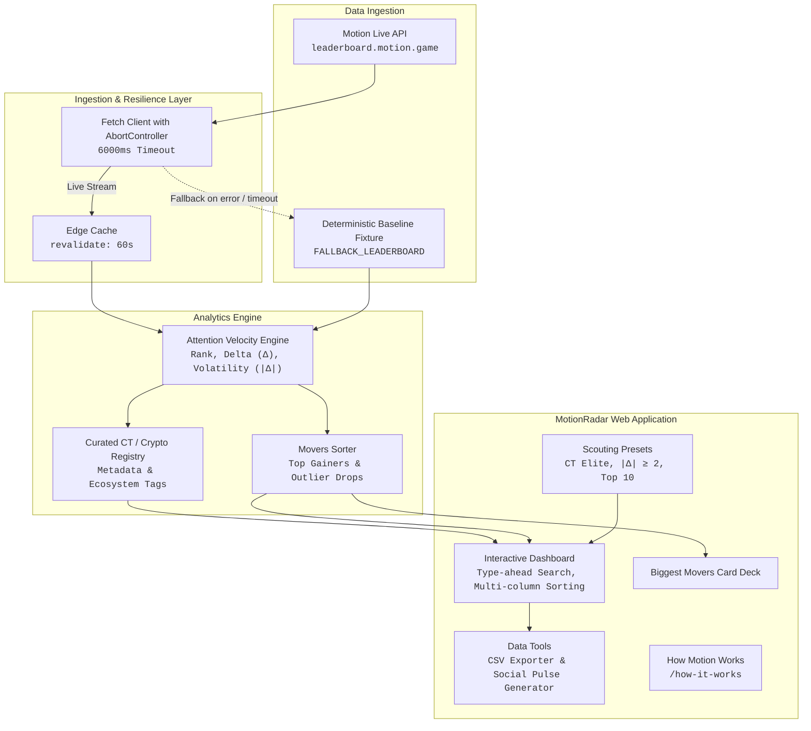

# MotionRadar 📡⚡

> Real-time momentum intelligence, attention velocity tracking, and leaderboard analytics for the [Motion](https://seats.motion.game) creator fantasy ecosystem.

[](https://motionradar.vercel.app)
[](https://nextjs.org/)
[](https://www.typescriptlang.org/)
[](scripts/test-verification.mjs)
[](LICENSE)

---

### 🏆 Sponsor & Ecosystem Evidence Matrix ("The Receipt Box")

| Sponsor / Track | Integration & Artifact | Verification Link | Source Permalink |
| :--- | :--- | :--- | :--- |
| **Motion Official** (`@motiongame_`) | Live Leaderboard Ingestion & Real-Time Edge Cache | [`leaderboard.motion.game`](https://leaderboard.motion.game/api/leaderboard) | [`src/lib/api.ts`](src/lib/api.ts) |
| **Motion Seats** (`seats.motion.game`) | Genesis Access Explainer, Wave Criteria & Seat Meta | [`seats.motion.game`](https://seats.motion.game) | [`src/components/HowItWorksContent.tsx`](src/components/HowItWorksContent.tsx) |
| **Mogathon** (`@callmogbot`) | Scout Lineup Sharing, Market Pulse, `#MotionSeats` | [`x.com/callmogbot`](https://x.com/callmogbot) | [`src/components/MogathonModal.tsx`](src/components/MogathonModal.tsx) |
| **Zero-Config Sandbox** | 100% Offline Fixture Fallback & CI Immune Suite | Verified with `npm test` | [`src/lib/fixture-data.ts`](src/lib/fixture-data.ts) |

---

## Overview

[Motion](https://seats.motion.game) is a creator fantasy sports game where players collect digital creator cards, draft weekly 5-person lineups, and score points based on cultural velocity across X, Instagram, TikTok, and YouTube.

Because scoring depends on rapid shifts in attention rather than static follower counts, scouting breakout creators before lineup locks requires real-time momentum data.

**MotionRadar** connects directly to the live Motion leaderboard to provide an analytics terminal for players, scouts, and creators:
- **Quantify Attention Velocity**: Tracks live ranks and instantaneous rank changes ($\Delta$) against comparative capture baselines.
- **Spot Volatility Outliers**: Highlights top movers sorted by absolute rank change ($|\Delta|$).
- **Curated Crypto / CT Segment**: Indexes leading Web3 founders, thinkers, and personalities (Vitalik, Cobie, Ansem, Toly, etc.).
- **Scouting Presets & Export**: One-click filters for high-volatility creators, instant CSV export, and market pulse summaries.
- **Motion Seats & Wave Intel**: Strategic guidance for [Motion Seats](https://seats.motion.game) Wave 1 and Wave 2 holders.
- **How Motion Works**: Interactive explainer covering Stars, Rarity, Score Boosts, and lineup strategy in under a minute.
- **Zero-Friction Reliability**: Edge-cached queries with automatic failover to local snapshot data if the upstream API is unreachable.

---

## Motion Seats & Wave Access

[Motion Seats](https://seats.motion.game) are limited genesis access passes assigned in sequential waves (Wave 1, Wave 2) to active creators, scouts, and builders who drive social attention.

> *"Actions create motion. So act."*

- **3-Step Seat Verification**:
  1. **Connect X**: Authorize your active creator or scout handle on X.
  2. **Check Eligibility**: Algorithmic scoring based on attention velocity, social mindshare, and ecosystem builder activity (such as participating in Mogathon).
  3. **Claim Seat**: Unlock Wave 1 / Wave 2 entry to the upcoming season.
- **Seat Meta in MotionRadar**: Use the **Seat Meta** preset chip to filter creators who have $+2$ or greater positive velocity ($\Delta \ge 2$), providing the optimal low-star breakout anchors for weekly fantasy lineups.

---

## How Motion Works

New to Motion? Visit the [How it Works](https://motionradar.vercel.app/how-it-works) page for a clear walkthrough of:

- Motion Score (Attention Velocity)
- Stars and the Star Cap
- Rarity and Score Boosts
- Building a 5-creator lineup
- The weekly loop
- Motion Seats and Wave eligibility

---

## Keyboard Shortcuts (Linear-Grade Navigation)

MotionRadar features keyboard-first navigation designed for pro scouts and power users:

| Shortcut | Action | Description |
| :--- | :--- | :--- |
| `/` or `⌘K` / `Ctrl+K` | **Focus Search** | Instantly focus the creator search input |
| `B` | **Motion Board** | Toggle your 4-tier Motion Board modal |
| `M` | **Market Pulse** | Open the Mogathon / X market pulse modal |
| `Esc` | **Close / Dismiss** | Dismiss any open modal or unfocus search input |

---

## System Architecture



---

## Features

### Attention Velocity Engine
Scoring in Motion reflects momentum. MotionRadar calculates both directional movement ($+\Delta$ gainers and $-\Delta$ droppers) and absolute volatility ($|\Delta|$) to identify who is gaining or losing cultural traction.

### Biggest Movers Radar
A high-contrast card grid featuring the creators with the largest rank shifts in the current period, letting scouts spot breakouts before market prices adapt.

### Curated Crypto Twitter (CT) Hub
A dedicated view for the Web3 and CT creator sphere, pre-indexing leaders such as Vitalik Buterin, Anatoly Yakovenko (Toly), Cobie, Ansem, Threadguy, and Clemente.

### How Motion Works Explainer
A dedicated page that walks new players through the core mechanics in under a minute: Motion Score, Stars, Rarity & Score Boosts, lineup building under the Star Cap, and the weekly loop.

### Weekly 5-Creator Lineup Builder & Viral X Share
Players draft a 5-person roster each week in Motion. MotionRadar includes an interactive floating lineup dock:
- **Real-Time Lineup Draft**: Add/remove any creator with 1 click from the leaderboard table or Biggest Movers deck.
- **Combined Momentum Score**: Real-time summation of net velocity ($\sum \Delta$) across your 5 drafted picks.
- **1-Click Share to X**: Instantly opens a pre-formatted viral scouting breakdown tagging `@motiongame_`, `@callmogbot`, `#Motion`, `#MotionSeats`, and `#Mogathon`.
- **Instant Auto-Draft Presets**: 1-click auto-drafts the top 5 velocity gainers or top 5 Crypto/CT stars.

### My Motion Board (Tier Maker & Personal Theses)
Built for Mogathon, **My Motion Board** lets scouts and players build, tier, and publish their personal creator rankings using live leaderboard data:
- **4 Strategic Tiers**:
  - 🔥 **Must-Haves**: Core allocation anchors and explosive breakout momentum targets.
  - 💎 **Value Picks**: High-conviction creators trading at oversold contrarian pullbacks.
  - ⚡ **Sleepers**: Mid-tier climbers and CT natives building stealth attention under the radar.
  - ⚠️ **Pass**: Overextended names or fading momentum with drawdown risk.
- **One-Line Thesis & Contextual Templates**: Suggests tailored thesis starters based on real-time delta and tier (e.g. *"Breakout velocity with explosive market rotation"*, *"Contrarian dip; prime rebound setup"*).
- **Interactive Management**: Move picks up/down, swap between tiers, or draft directly from the leaderboard table and mover cards.
- **One-Click Auto-Suggest Board**: Instantly drafts a balanced board using live gainers, CT movers, contrarian dips, and fading names.
- **Persistent & Portable**: Persisted locally in `localStorage` (`motionradar_motion_board_v1`) and synced with live leaderboard refreshes.
- **Public Board Links & Share Preview**: Generates compact URL-safe query links (`?board=...`) and an editable share preview before publishing directly to X tagging `@callmogbot` and `@motiongame_ #Mogathon`.

### Resilient Avatar Engine & Real-Time Pulse
- **Zero Broken UI States**: Deterministic high-contrast gradient initials avatar engine with graceful photo fallbacks if CDNs fail.
- **Fast 25s Cache Refresh**: Drop cache down to ~25s with a live ticking "Updated Xs ago" indicator that updates in real time.

### Analytical Scout Signals
Provides actionable scouting theses beyond raw numbers:
- **🚀 Breakout Velocity**: Creators moving $\ge +3$ spots with rapid attention rotation.
- **📉 Oversold Dip**: High-conviction creators undergoing temporary rank drops (contrarian rebound targets).
- **⚡ CT Momentum**: Crypto-native creators riding active Web3 / CT mindshare.
- **💎 CT Discount**: Top crypto builders trading at a relative rank discount.
- **🛡️ Blue Chip**: Top-5 cultural juggernauts anchoring the leaderboard.
- **👀 Hidden Gem**: Mid/lower-tier creators climbing quietly with $\ge +2$ delta.
- **✨ New Catalyst**: Fresh entries into the leaderboard.

### Fast Scouting Presets
- **Seat Meta**: Isolates high-momentum breakout creators ($\Delta \ge 2$) optimal for weekly fantasy lineups.
- **CT Elite**: Isolates verified Crypto Twitter creators.
- **$|\Delta| \ge 2$**: Filters out static positions to show creators undergoing notable movement.
- **Top 10**: Focuses on the current leaderboard leaders.
- **Contrarian Dips**: Surfaces oversold creators poised for rebound.

### Live X Pulse Catalyst Scouting
- Direct 1-click **Pulse** links (`https://x.com/search?q=from%3A{handle}&f=live`) beside every creator handle in the leaderboard table, allowing scouts to view live posts on X and diagnose breaking cultural momentum drivers instantly.

### Data Tools & Social Pulse
- **Export to CSV**: Instant client-side download of the active, filtered dataset.
- **Market Pulse Modal**: Generates structured, pre-formatted scouting updates ready to share to social channels or `@callmogbot`.

### Resilient by Design
Built with an edge-revalidation pipeline (`revalidate: 60`) and a local fallback snapshot. The application remains fully functional and testable without requiring API keys or external dependencies.

---

## Getting Started

### Prerequisites
- Node.js 18+ (tested on Node 20 LTS and Node 22)
- npm, pnpm, or yarn

### Installation

```bash
# Clone the repository
git clone https://github.com/kellycryptos/MotionRadar.git
cd MotionRadar

# Install dependencies
npm install
```

### Verification Tests

Run the test suite to verify data structures, calculations, and CT creator detection:

```bash
npm test
```

### Development Server

```bash
npm run dev
```

Open [http://localhost:3000](http://localhost:3000) in your browser.

### Production Build

```bash
npm run build
npm start
```

---

## Data Model

```typescript
export interface LeaderboardCreator {
  id: string;          // Unique creator identifier
  name: string;        // Creator display name
  position: number;    // Current 1-based rank
  delta: number;       // Change vs previous capture (+/-)
  isNew: boolean;      // First-time leaderboard entry
}

export interface LeaderboardResponse {
  asOf: string;               // Timestamp of generation
  capturedAt: string;         // Current telemetry capture
  baselineCapturedAt: string; // Baseline capture timestamp
  history: string;            // Tracking window label
  rows: LeaderboardCreator[]; // Array of ranked creators
}
```

---

## Architecture & Implementation Reference

| Component | Description | Source Reference |
| :--- | :--- | :--- |
| **API Ingestion** | Live endpoint fetch with timeout handling and automatic fallback | [`src/lib/api.ts`](src/lib/api.ts) |
| **Movers Logic** | Absolute rank volatility and momentum sorting | [`src/lib/api.ts`](src/lib/api.ts) |
| **Crypto Registry** | Curated metadata mapping for Web3 and CT figures | [`src/lib/crypto-creators.ts`](src/lib/crypto-creators.ts) |
| **Fallback Fixture** | Deterministic baseline snapshot for zero-config operation | [`src/lib/fixture-data.ts`](src/lib/fixture-data.ts) |
| **How It Works** | Under-a-minute explainer of Stars, Rarity, Boosts, and lineups | [`src/app/how-it-works/page.tsx`](src/app/how-it-works/page.tsx) |
| **Pulse Generator** | Pre-formatted market pulse generator for community sharing | [`src/components/MogathonModal.tsx`](src/components/MogathonModal.tsx) |
| **Verification Suite** | Automated unit and data integrity tests | [`scripts/test-verification.mjs`](scripts/test-verification.mjs) |

---

## Roadmap

- [x] **Phase 1: Telemetry & Core Analytics**
  - Live leaderboard ingestion with 60s background revalidation.
  - Biggest Movers detection, CT curation, and multi-column sorting.
  - Offline snapshot resilience and test suite.
- [x] **How Motion Works Explainer**
  - Under-a-minute walkthrough of Stars, Rarity, Score Boosts, and lineup strategy.
- [ ] **Phase 2: Historical Trajectories**
  - Creator sparklines showing 7-day and 30-day rank trajectories.
  - Historical volatility indexes and momentum score calculations.
- [ ] **Phase 3: Web3 & Squad Tools**
  - Wallet integration to import owned Motion creator cards.
  - Automated weekly 5-card lineup simulator maximizing expected positive delta.
- [ ] **Phase 4: Real-Time Alerts**
  - Webhook alerts (Discord/Telegram) for sudden rank movements ($|\Delta| \ge 5$).

---

## License

This project is open-source under the [MIT License](LICENSE).
